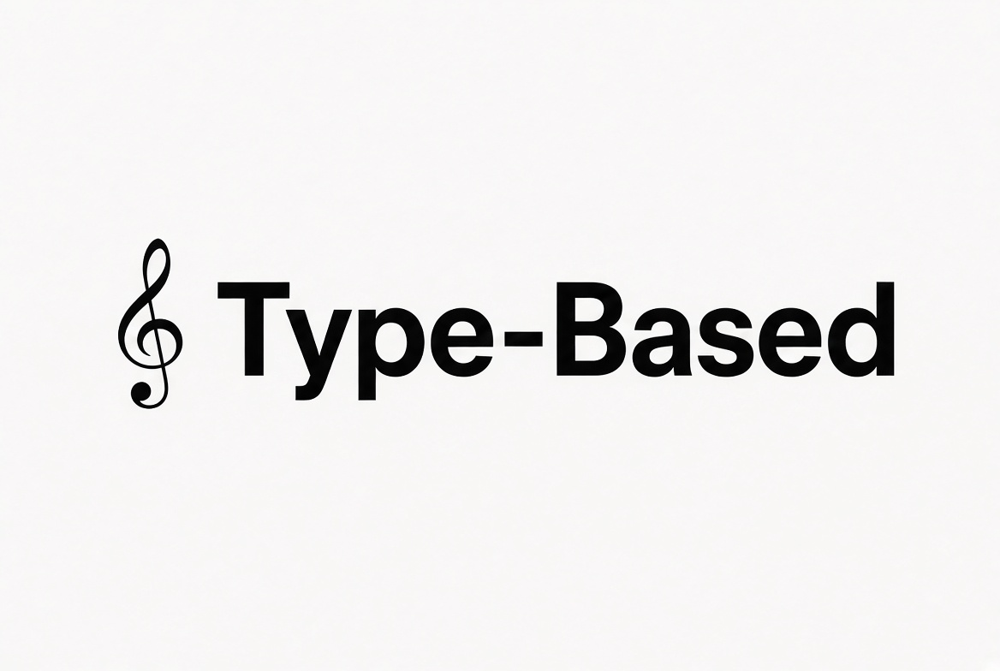
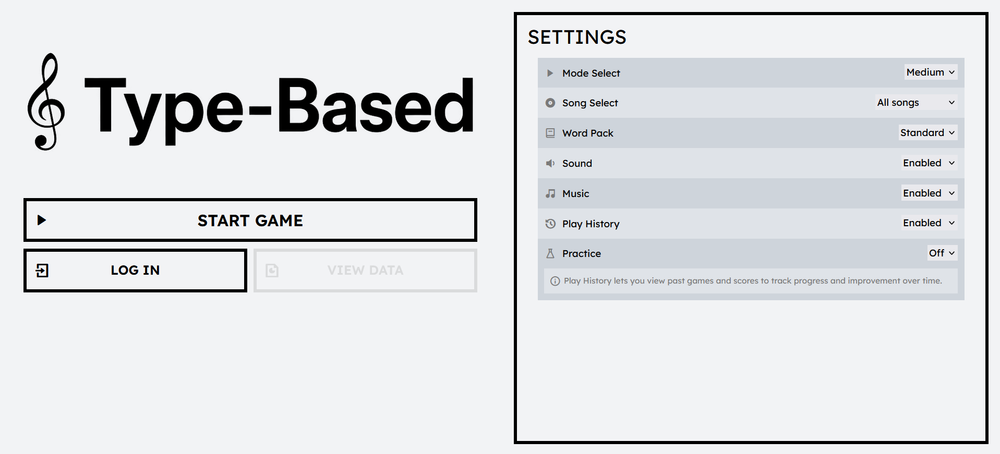
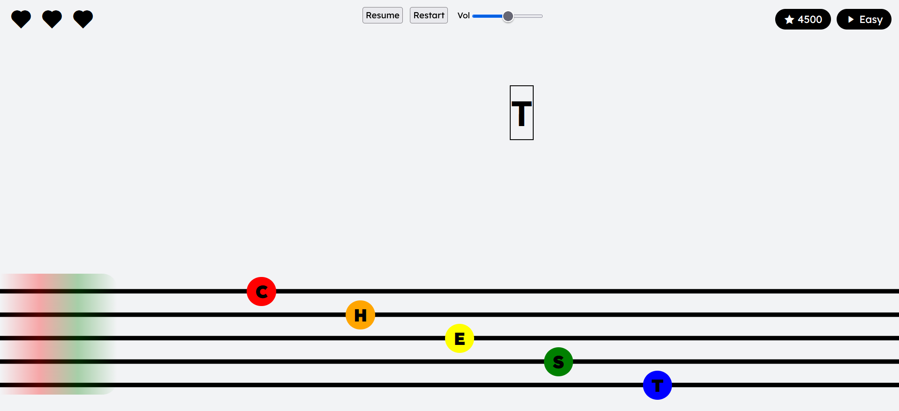
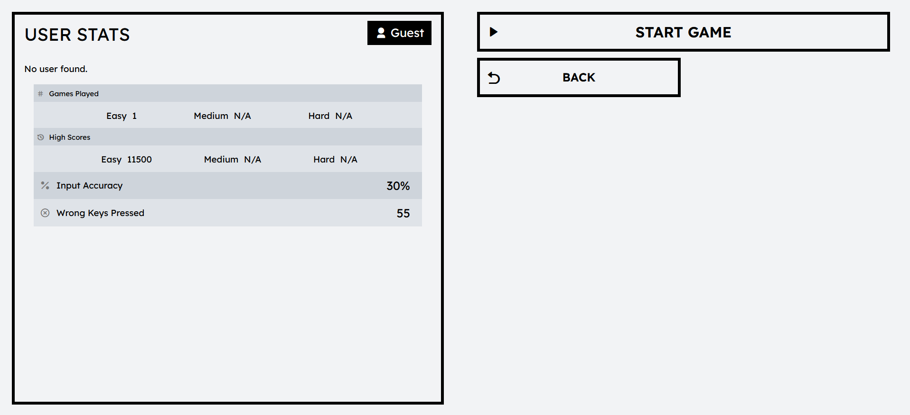

# Type-Based

A browser typing game with falling letters, difficulty modes, accounts, and player statistics.

**Version:** 2.0  
**Stack:** PHP, JavaScript, CSS, SQLite

## Running the project
PHP is required. On a Mac or Linux, also install the SQLite extension. Accounts and stats use the game’s own sign-in.

Windows:

```bat
start.bat
```

Mac or Linux:

```bash
chmod +x start.sh
./start.sh
```

Or start it by hand from the project folder:

```bash
php -S localhost:8000
```

Then open http://localhost:8000/Index.php

A local run uses the SQLite file in `data/`.

## Screenshots
Menu



Game



Stats



## Project structure
- `Index.php` — main menu: mode and song selection, sign-in, and account creation
- `FrontEnd/` — the game page, the stats page, and the word lists
- `BackEnd/` — login, account creation, and saving or loading player stats
- `Database/` — the local SQLite schema
- `nrs-projects/` — old campus Oracle files, not used locally
- `CSS/` — layout and control styles
- `Assets/` — images and audio used by the game

## Future updates for version 3.0
- `Security` — Improve potential Security flaws related to the game.
- `Server` — Have the potential to move the server locally or off the campus servers.
- `Dictionary` — Source 5-letter dictionary words from American-English
## Team
Type-Based

## Contributors
- Chan Rain
- Garrett Willis
- Kevin Tieu

## License
See `LICENSE`.

**Last updated:** October 20, 2026
