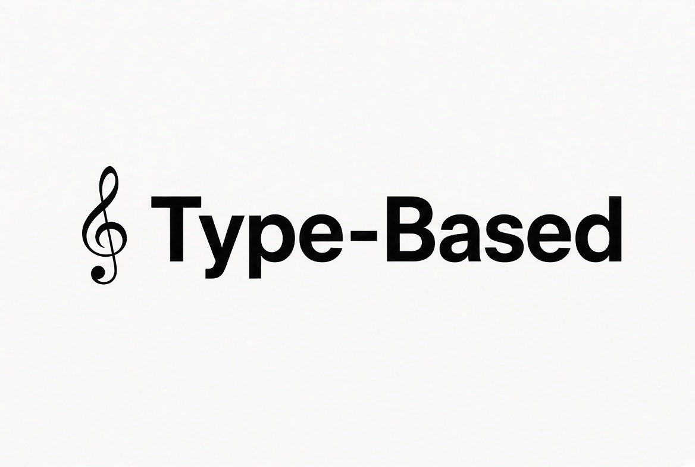

# Type-Based

A browser typing game with falling letters, difficulty modes, accounts, and player statistics.

**Version:** 1.0  
**Stack:** PHP, JavaScript, CSS, Oracle

## Running the project
Live site: https://nrs-projects.humboldt.edu/~crm183/Type-Based/Index.php

The site is public. No student login is required to open it. Accounts and stats use the game’s own sign-in. The pages expect the Humboldt Oracle PHP connection used by the course (`hum_conn_no_login.php`).

## Screenshots
<!-- Replace these lines with image links once the shots are taken. -->
- Menu: placeholder
- Game: placeholder
- Stats: placeholder

## Project structure
- `Index.php` — main menu: mode and song selection, sign-in, and account creation
- `FrontEnd/` — the game page, the stats page, and the word lists
- `BackEnd/` — login, account creation, and saving or loading player stats
- `Database/` — the Oracle table design and sample data
- `CSS/` — layout and control styles
- `Assets/` — images and audio used by the game

## Team
Type-Based

## Contributors
- Chan Rain
- Garrett Willis
- Kevin Tieu

## License
See `LICENSE`.

**Last updated:** October 15, 2026
